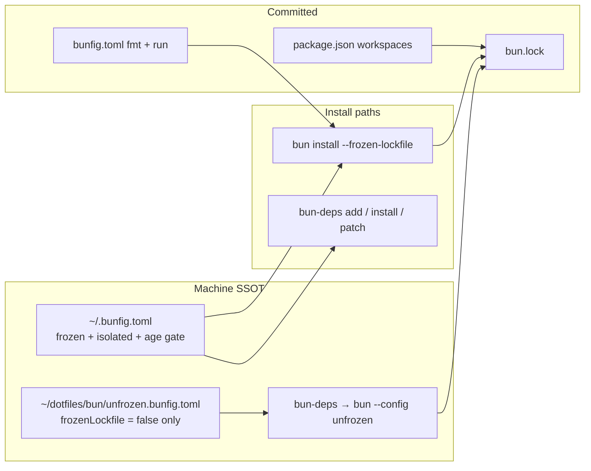
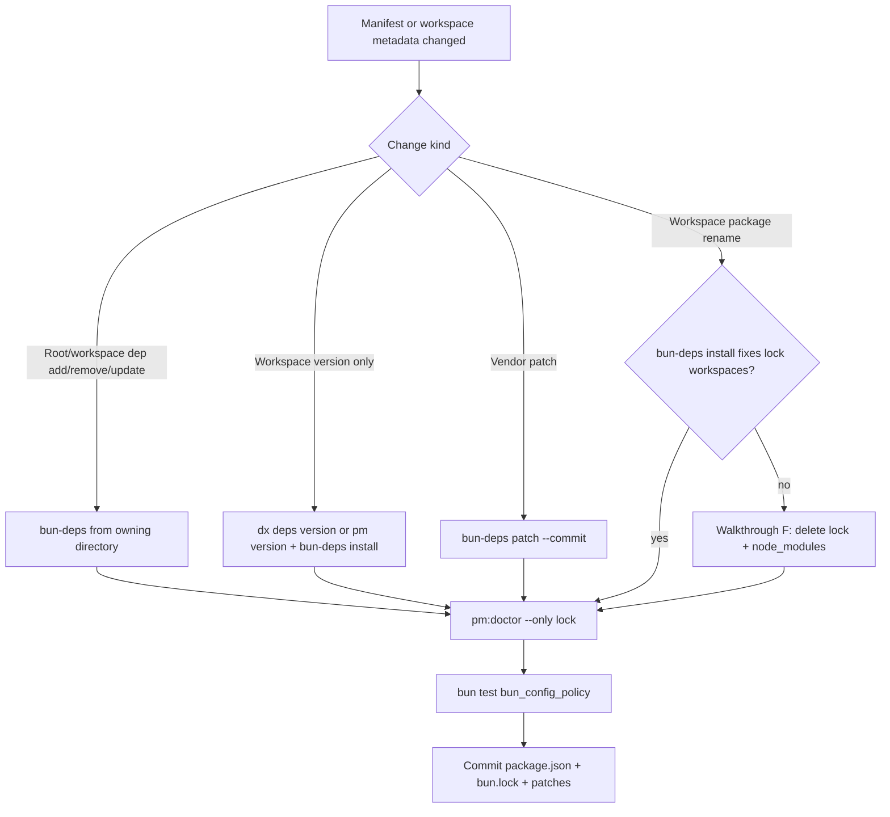

# Bun package manager policy

**Runtime:** Bun 1.4.4 only. **Upstream doc routing:** [bun-upstream-reference.md](../bun-upstream-reference.md) (types, JSC, oven-sh pins).

Procedural SSOT for installs, `bun.lock`, machine bunfig, and `bun-deps`. Implementation SSOT: `lib/pm_policy.ts`, `scripts/pm_doctor.ts`, tests in [Automated gates](#automated-gates).

| If you need…            | Jump to                                                                                                            |
| ----------------------- | ------------------------------------------------------------------------------------------------------------------ |
| Change a dependency     | [Walkthroughs](#walkthroughs-maintainer-machines) B, [Lock refresh decision](#lock-refresh-decision)               |
| Fix CI frozen install   | [When installs fail](#when-installs-fail-quick-triage), [Parity matrix](#parity-frozen-install-vs-doctor-vs-tests) |
| New laptop setup        | Walkthrough **E**, [Global bunfig footguns](#global-bunfig-footguns-124)                                           |
| What `pm:doctor` checks | [`pm:doctor` check catalog](#pmdoctor-check-catalog)                                                               |
| Forbidden shortcuts     | [Forbidden or policy-breaking](#forbidden-or-policy-breaking-do-not-fix-ci-by-doing-these)                         |

## Upstream `bun install` vs this repo

Reference: [pm/cli/install](https://bun.com/docs/pm/cli/install).

**Default behavior (upstream).** Installs `dependencies`, `devDependencies`, `optionalDependencies`, and peers; writes text `bun.lock`; runs the **root** `{pre|post}install` and `{pre|post}prepare` scripts. Dependency lifecycle scripts follow the [lifecycle → `trustedDependencies`](https://bun.com/docs/pm/lifecycle#trusteddependencies) rules (three modes below). Bun may still apply **native dependency linker** shortcuts for some packages without listing them in `trustedDependencies` ([install → lifecycle](https://bun.com/docs/pm/cli/install#lifecycle-scripts)); that is separate from the default npm allow list.

**Config load order.** Bun merges global then project `bunfig.toml` ([runtime/bunfig](https://bun.com/docs/runtime/bunfig)): `$XDG_CONFIG_HOME/.bunfig.toml` when `XDG_CONFIG_HOME` is an **absolute** path, otherwise `$HOME/.bunfig.toml`, then `./bunfig.toml`. Project keys override global for the same key. Live path resolution: `globalBunfigPath()` in `lib/pm_policy.ts`.

| Topic                 | Upstream                                                                                                                                                                                                        | This repo                                                                                                                   |
| --------------------- | --------------------------------------------------------------------------------------------------------------------------------------------------------------------------------------------------------------- | --------------------------------------------------------------------------------------------------------------------------- |
| Reproducible install  | `--frozen-lockfile`, `bun ci`, or pnpm `--immutable`; **not** enabled automatically in CI                                                                                                                       | `.github/workflows/ci.yml`, README: `bun install --frozen-lockfile`; `ci:local --install`                                   |
| Lock vs manifest      | Adds/removes/version bumps fail frozen and name the first drift; range-only edits, dependency group moves, workspace `version`/`bin`/`scripts`, `trustedDependencies`, and `patchedDependencies` can still pass | `pm:doctor` still flags workspace **version** and **patch** drift in `bun.lock`; run `bun-deps install` and commit the lock |
| Validate lock only    | `bun install --frozen-lockfile --dry-run` (no `node_modules`, no root lifecycle)                                                                                                                                | Same flags when debugging CI install failures                                                                               |
| Changing deps         | `bun add` / `remove` / `update`                                                                                                                                                                                 | Global `install.frozenLockfile = true` → `bun-deps` / `bun run deps` (`AGENTS.md`)                                          |
| Linker / supply chain | `hoisted` vs `isolated`; monorepos default toward isolated via lock `configVersion`                                                                                                                             | `pm:doctor` expects **isolated** linker on the machine config                                                               |
| Release age           | `minimumReleaseAge` in bunfig or `--minimum-release-age`                                                                                                                                                        | Machine gate (typically 3 days); `pm:doctor` "release age gate"                                                             |
| Lockfile on disk      | Commit `bun.lock`; Yarn/pnpm/`bun.lockb` migration when no `bun.lock`                                                                                                                                           | Only `bun.lock` in git; foreign lockfiles fail policy tests                                                                 |
| Trusted scripts       | Three modes ([lifecycle](https://bun.com/docs/pm/lifecycle#behavior-of-the-trusteddependencies-field))                                                                                                          | **`[]`** — replaces default list entirely (`tests/bun_config_policy.test.ts`)                                               |

Workspaces, `--filter`, overrides, `packageExtensions`, offline/prefer-offline, and isolated layout: [workspaces](https://bun.com/docs/pm/workspaces), [filter](https://bun.com/docs/pm/filter), [overrides](https://bun.com/docs/pm/overrides), [isolated installs](https://bun.com/docs/pm/isolated-installs), [global cache](https://bun.com/docs/pm/global-cache).

### Install policy stack



**Machine-owned `[install]` keys** (must not appear in repo `bunfig.toml`; enforced by `MACHINE_OWNED_INSTALL_KEYS`):

| Key                 | Upstream role                                                                                         | Expected on maintainer machines (`pm:doctor`) |
| ------------------- | ----------------------------------------------------------------------------------------------------- | --------------------------------------------- |
| `linker`            | `hoisted` vs `isolated` ([isolated installs](https://bun.com/docs/pm/isolated-installs))              | `isolated` → `node_modules/.bun/`             |
| `globalStore`       | Symlink installs into shared store ([global store](https://bun.com/docs/pm/global-store))             | Set in dotfiles; not duplicated in repo       |
| `cache`             | Cache directory / manifest cache                                                                      | Set in dotfiles                               |
| `frozenLockfile`    | Same as `--frozen-lockfile`                                                                           | `true` for plain `bun install` / `bun add`    |
| `minimumReleaseAge` | Block freshly published versions ([install](https://bun.com/docs/pm/cli/install#minimum-release-age)) | Non-zero (typically ~3 days)                  |

Maintainer machine config lives in **`~/dotfiles/bun/bunfig.toml`** (symlinked to the live global path). Typical shape beyond the table:

- `globalStore = true` with **isolated** linker → installs symlink through `node_modules/.bun` into the shared store ([global store](https://bun.com/docs/pm/global-store)).
- `minimumReleaseAgeExcludes` — package names (or exact versions) that **skip** the age gate; dotfiles keeps Bun/types tooling on a faster cadence than arbitrary npm packages.
- `[install.cache] dir` — **absolute** path under `$HOME/.bun/install/cache` (unexpanded `~` in bunfig is a known footgun).

Also avoid duplicating scoped registries in bunfig; Bun reads **`~/.npmrc`** for `@scope:registry` and tokens.

### Global bunfig footguns (1.4.4)

| Pitfall                              | Symptom                                                                                                  | Fix                                                                                                                 |
| ------------------------------------ | -------------------------------------------------------------------------------------------------------- | ------------------------------------------------------------------------------------------------------------------- |
| **XDG vs `$HOME`**                   | With `XDG_CONFIG_HOME` set, Bun reads **only** `$XDG_CONFIG_HOME/.bunfig.toml`, not `$HOME/.bunfig.toml` | Symlink dotfiles bunfig to the XDG path; `pm:doctor` "inert bunfig" warns when a stale `$HOME/.bunfig.toml` differs |
| **Missing symlink**                  | Installs use Bun **defaults** (hoisted, no age gate) while you think policy is active                    | Ensure the live global file exists; doctor `global bunfig` + `isolated linker`                                      |
| **`~/.bun/bunfig.toml`**             | Policy never applies                                                                                     | Not a Bun config path                                                                                               |
| **Project overrides machine keys**   | Repo would fork install policy per clone                                                                 | Forbidden — `tests/bun_config_policy.test.ts`; also avoid `[install.cache]` in repo `bunfig.toml`                   |
| **`frozenLockfile` + no `bun.lock`** | Bun **1.4.4**: install can exit **0** and write **no** lock                                              | This repo always commits `bun.lock`; CI and `lockfile` doctor check require it                                      |
| **`bun --config` placement**         | Override ignored                                                                                         | Flag must precede the subcommand: `bun --config=… install`, not `bun install --config=…`                            |

**`bun-deps` (dependency writes).** Shell wrapper in `~/dotfiles/shell/bin/bun-deps` runs `bun --config="$HOME/dotfiles/bun/unfrozen.bunfig.toml" …`. On **1.4.4**, a frozen global config is **not** cleared by `--no-frozen-lockfile` or `BUN_CONFIG_*` env vars — only a different config file via `--config` wins. The override file must contain **only** `frozenLockfile = false` (plus nothing else in `[install]`); `pm:doctor` fails if it sets other install keys. All other machine policy (isolated linker, release age, cache) still applies during `bun-deps` runs.

### Lifecycle scripts (upstream three modes)

| `trustedDependencies` in root `package.json` | Dependency postinstall behavior                                                                                                                |
| -------------------------------------------- | ---------------------------------------------------------------------------------------------------------------------------------------------- |
| **Omitted**                                  | Bun’s [default allow list](https://github.com/oven-sh/bun/blob/main/src/install/default-trusted-dependencies.txt) (npm registry packages only) |
| **Explicit array**                           | **Only** listed names; default list ignored                                                                                                    |
| **`[]` (this repo)**                         | **No** dependency lifecycle scripts, including none from the default list                                                                      |

Root `package.json` `{pre|post}install` / `{pre|post}prepare` still run on install unless `--ignore-scripts`. This repo pins `trustedDependencies` to `[]` and mirrors it in `bun.lock` so lockfile-only drift is visible. **Oxlint** ships platform `@oxlint/binding-*` optional packages as prebuilt tarballs (lockfile lists `os` / `cpu` / `libc`); there are no `patchedDependencies` / `overrides` on the root manifest today.

### `bun.lock` shape here

Measured on the committed lock (Bun 1.4.4 text format):

| Field                      | Value / meaning                                                                                                    |
| -------------------------- | ------------------------------------------------------------------------------------------------------------------ |
| `lockfileVersion`          | `2` ([lockfile](https://bun.com/docs/pm/lockfile))                                                                 |
| `configVersion`            | `1` → isolated linker default for workspaces                                                                       |
| `workspaces[""]`           | Root `@tennis-hq/sportsdesk-workspace` holds **all** npm dependencies                                              |
| `workspaces["packages/…"]` | Workspace **name** + **version** only (no nested deps yet)                                                         |
| Root workspace version     | **Not** stored under `workspaces[""]` (Bun omits it); doctor compares versions only for `packages/*`               |
| `packages`                 | Resolved graph including optional platform packages (e.g. oxlint bindings) skipped at install time on other OS/CPU |
| `trustedDependencies`      | `[]`, must stay aligned with `package.json`                                                                        |

Policy tests recompute expected workspace keys from globbed `package.json` files and compare to the lock (`lockWorkspaceNames`, `lockWorkspaceVersions`, `patchState` in `lib/pm_policy.ts`) — stricter than `bun install --frozen-lockfile` alone.

**How the lock is read in-repo.** `lib/pm_policy.ts` parses `bun.lock` with `Bun.JSONC.parse` (JSONC tolerates the lock’s trailing commas and layout). Doctor/tests compare:

- `workspaces[<relative-dir>].name` and `.version` — keys are paths like `""`, `packages/sportsdesk-ops`, not npm package names.
- `patchedDependencies` — map of `package@range` → patch file path; manifest and lock must match byte-for-byte on keys and paths.

Drift lines look like `packages/foo: lock 1.0.0 vs 1.0.1` (`scripts/pm_doctor.ts` `drift()`).

**`FOREIGN_LOCKFILES`.** `package-lock.json`, `yarn.lock`, `pnpm-lock.yaml`, `bun.lockb` must not be committed. Upstream can migrate them into `bun.lock` on an unfrozen install when no `bun.lock` exists; this repo treats any foreign file as a policy failure. Migration procedure: on a maintainer machine with working `bun-deps`, run one unfrozen install that writes `bun.lock`, delete foreign files, commit **only** `bun.lock`, run `bun test tests/bun_config_policy.test.ts`.

### Forbidden or policy-breaking (do not “fix” CI by doing these)

| Action                                                                | Why                                                                                                 |
| --------------------------------------------------------------------- | --------------------------------------------------------------------------------------------------- |
| `bun add` / `remove` / `update` without `bun-deps`                    | Global frozen config exits **1** without writing; if it did write, bypasses the unfrozen audit path |
| `bun add --trust` / `bun pm trust` / populating `trustedDependencies` | Breaks `lifecycle scripts` doctor + policy test; re-enables dependency postinstall                  |
| `[install]` machine keys in repo `bunfig.toml`                        | Forks install policy per clone; fails `project bunfig`                                              |
| Committing foreign lockfiles                                          | Fails `lockfile` check                                                                              |
| Plain `bun patch --commit`                                            | Leaves `bun.lock` behind under frozen global config                                                 |
| Disabling frozen in **project** bunfig “for CI”                       | Wrong layer — CI uses the **flag**; machine uses global bunfig                                      |
| `bun install --no-save` on a manifest edit                            | Skips lock write; desyncs git                                                                       |

### `pm:doctor` check catalog

Implementation: `scripts/pm_doctor.ts`. Exit **1** if any selected check has status `fail`; `warn` does not fail. `--only <substring>` filters check **names** (comma-separated); `--only lock` stays offline (skips registry `fetch` unless filter matches `registry`, `token`, or `@…`).

| Check                      | Fail / warn | What it proves                                                        |
| -------------------------- | ----------- | --------------------------------------------------------------------- |
| `runtime pin`              | fail        | `Bun.version`, `engines.bun`, and `packageManager` agree on **1.4.4** |
| `lifecycle scripts`        | fail        | `trustedDependencies` is exactly `[]`                                 |
| `global bunfig`            | fail        | Live global config file exists (`globalBunfigPath`)                   |
| `inert bunfig`             | warn        | A second `~/.bunfig.toml` path exists but is not the live file        |
| `frozen lockfile`          | fail        | Global `install.frozenLockfile === true`                              |
| `isolated linker`          | fail        | Global `install.linker === "isolated"`                                |
| `release age gate`         | fail        | Global `minimumReleaseAge` is set and non-zero                        |
| `project bunfig`           | fail        | Repo `bunfig.toml` does not set machine-owned install keys            |
| `lockfile`                 | fail        | `bun.lock` present; none of `FOREIGN_LOCKFILES`                       |
| `lock workspaces`          | fail        | Workspace path → **name** matches lock                                |
| `lock versions`            | fail        | Each `packages/*` **version** matches lock                            |
| `patches`                  | fail        | `patchedDependencies` manifest = lock and patch files exist           |
| `nameless workspace`       | warn        | Matched `package.json` without `"name"` (Bun skips)                   |
| `installed tree`           | warn        | Missing `node_modules`, or hoisted layout without `node_modules/.bun` |
| `bun-deps command`         | fail        | `bun-deps` on `PATH`                                                  |
| `deps override`            | fail        | `unfrozen.bunfig.toml` exists; only `frozenLockfile = false`          |
| `@… registry` / `@… token` | warn / ok   | `.npmrc` scoped registry reachable; token env set when declared       |

### Verification layers (who catches drift)

| Layer                                         | Runs when                     | Proves                                                                                                                                                |
| --------------------------------------------- | ----------------------------- | ----------------------------------------------------------------------------------------------------------------------------------------------------- |
| **CI** `bun install --frozen-lockfile`        | GitHub / `ci:local --install` | Manifest dependency graph matches committed lock for **registry** adds/removes/versions; no machine bunfig assumed                                    |
| **`bun install --frozen-lockfile --dry-run`** | Manual                        | Same class of errors as CI without touching `node_modules`                                                                                            |
| **`tests/bun_config_policy.test.ts`**         | `bun test`                    | No foreign lockfiles; no machine keys in project bunfig; `trustedDependencies: []`; lock workspace **names/versions** and **patches** match manifests |
| **`tests/pm_policy_workspaces.test.ts`**      | `bun test`                    | `resolveWorkspaces()` matches the lock Bun writes for synthetic fixtures (glob / `!` / literal-path edge cases)                                       |
| **`pm:doctor` / `dx deps check`**             | Maintainer machine            | Everything above **plus** global bunfig, isolated tree, `bun-deps` wiring, optional registry ping                                                     |
| **`bun run probe:bun`**                       | After Bun upgrade             | Runtime one-liner behavior vs `tests/bun_baseline.json` (not PM, but paired with pin checks)                                                          |

### Parity: frozen install vs doctor vs tests

| Situation                                     | CI frozen                       | `bun_config_policy`                                                                          | `pm:doctor`                      |
| --------------------------------------------- | ------------------------------- | -------------------------------------------------------------------------------------------- | -------------------------------- |
| New npm dep/version in root `package.json`    | **Fail**                        | **Fail** (lock mismatch on next unfrozen install not required — tests read lock vs manifest) | **Fail** when lock columns drift |
| Workspace `version` bump, lock stale          | **Pass**                        | **Fail** (`lock versions`)                                                                   | **Fail**                         |
| Workspace `name` rename, lock stale           | **Pass**                        | **Fail** (`lock workspaces`)                                                                 | **Fail**                         |
| `patchedDependencies` in manifest, lock stale | **Pass** (if frozen allows)     | **Fail** (`patches`)                                                                         | **Fail**                         |
| Hoisted `node_modules` (no `.bun`)            | **Pass** if lock OK             | **Pass**                                                                                     | **Warn** (`installed tree`)      |
| Global bunfig missing / wrong linker          | **Pass** on CI (ubuntu default) | **Pass**                                                                                     | **Fail**                         |
| `@tennis-hq` registry down                    | **Pass** for npmjs root deps    | **Pass**                                                                                     | **Warn**                         |

### Frozen install traps (repo checks)

Upstream frozen install can **pass** while `bun.lock` is stale. `lib/pm_policy.ts` and `pm:doctor` catch what CI frozen install does not:

| Trap                                                | What happens                                                                        | Fix                                                                                                                                 |
| --------------------------------------------------- | ----------------------------------------------------------------------------------- | ----------------------------------------------------------------------------------------------------------------------------------- |
| Workspace **rename** (`package.json` `name`)        | Bun 1.4.4 does not rewrite names in an existing lock; frozen does not compare names | `bun-deps install` if enough; else delete `bun.lock` + `node_modules` and reinstall unfrozen, then commit; verify `lock workspaces` |
| Workspace **version** bump (`bun pm version`)       | Frozen install still applies; lock can keep the old version                         | `bun-deps install`, or `./bin/dx deps version <ver>` (bumps, refreshes lock, runs doctor on lock checks)                            |
| **`bun patch --commit`** under frozen global config | Patch file and `package.json` update; **`bun.lock` may not**                        | `bun-deps patch --commit <dir>` (plain `bun patch --commit` skips the lock)                                                         |

Catalog and workspace-scoped adds: run **`bun-deps`** (or `bun run deps` / `./bin/dx deps`) **in the package that should own the dependency** — `./bin/dx deps` deliberately does not `cd` to the repo root.

### Operator commands

| Goal                          | Command                                                                                                              |
| ----------------------------- | -------------------------------------------------------------------------------------------------------------------- |
| Clone / CI parity             | `bun install --frozen-lockfile` (README, `.github/workflows/ci.yml`; local full chain: `bun run ci:local --install`) |
| Machine policy audit          | `bun run pm:doctor` or `./bin/dx deps check`                                                                         |
| Lock drift only (offline)     | `bun run pm:doctor --only lock` (matches workspaces, versions, patches)                                              |
| Manifest vs lock (no install) | `bun install --frozen-lockfile --dry-run`                                                                            |
| Change dependencies           | `bun-deps add                                                                                                        | remove | update | install …`via`deps`/`dx deps`(uses`~/dotfiles/bun/unfrozen.bunfig.toml`with`frozenLockfile = false` only) |

`pm:doctor` is read-only (no install). Registry probes for `@tennis-hq` are **warn**-level and skipped when `--only` filters exclude registry/token names.

### Which config loads for which command

| Command class                                                        | Reads global `[install]` bunfig | Reads project `bunfig.toml`                                   |
| -------------------------------------------------------------------- | ------------------------------- | ------------------------------------------------------------- |
| `bun install` / `add` / `remove` / `update` / `patch` / `bun-deps …` | Yes                             | Yes (`[install]` overrides if set — **must stay empty here**) |
| `bun test`, `bun run`, `bun --watch`, most scripts                   | No                              | Yes (`[run]`, `[test]`, `[fmt]`, …)                           |

So **`[run] noOrphans`** applies to test/runtime commands even though install policy is machine-global only.

### Walkthroughs (maintainer machines)

**A. Fresh clone**

```sh
bun --version    # 1.4.4
bun install --frozen-lockfile
bun run pm:doctor
bun test tests/bun_config_policy.test.ts
```

**B. Add or bump a root dependency** (from repo root; graph lives on the root workspace)

```sh
bun-deps add -d oxlint@1.90.0          # example: exact pin matches house style
# or: bun-deps update oxlint
bun run pm:doctor --only lock
bun test tests/bun_config_policy.test.ts
git add package.json bun.lock
```

If resolution fails with **minimum release age**, the version was published inside the machine window — wait, pick an older version, or (dotfiles-only) add an exclude for that package ([install → minimum release age](https://bun.com/docs/pm/cli/install#minimum-release-age)). `@types/bun`, `typescript`, etc. are typically pre-excluded on maintainer configs.

**C. Bump a workspace package version** (`packages/sportsdesk-ops`, etc.)

```sh
cd packages/sportsdesk-ops
../../bin/dx deps version 1.0.1        # bun pm version + bun-deps install + doctor lock checks
cd ../..
git add packages/sportsdesk-ops/package.json bun.lock
```

**D. Patch a dependency** (when you introduce `patchedDependencies`)

```sh
bun patch <pkg>@<locked-version>       # can use bun-deps if you wrap patch subcommands
# edit the tree Bun opens
bun-deps patch --commit <patch-dir>    # writes patch file, manifest, and bun.lock
bun run pm:doctor --only patches,lock
```

**E. New maintainer machine**

1. Install **Bun 1.4.4** (match `.bun-version`).
2. Link **`~/dotfiles/bun/bunfig.toml`** → live global path (`$XDG_CONFIG_HOME/.bunfig.toml` when XDG is set).
3. Put **`bun-deps`** on `PATH` (`~/dotfiles/shell/bin/bun-deps` → `~/.local/bin`).
4. Confirm **`~/dotfiles/bun/unfrozen.bunfig.toml`** exists (only `frozenLockfile = false`).
5. Clone repo → walkthrough **A**.

**F. Regenerate `bun.lock` from scratch** (workspace renames, corrupted lock, foreign migration)

```sh
rm -rf node_modules bun.lock
bun-deps install                         # unfrozen; re-resolves entire graph under age gate + isolated linker
bun run pm:doctor
bun test tests/bun_config_policy.test.ts tests/pm_policy_workspaces.test.ts
git add bun.lock
```

### Lock refresh decision



### Workspaces

Root manifest: `"workspaces": ["packages/*"]`. Packages under `packages/` currently carry **no** workspace-local dependencies (root owns the graph). **`--catalog`** / `bun-deps add --catalog` is supported for future root catalogs; there is no catalog block in `package.json` yet.

**`resolveWorkspaces()` algorithm** (must match Bun’s lock keys):

1. Parse `workspaces` as a string array or `{ packages: [...] }`.
2. Collect negated globs (`!…`) first; for each positive glob, scan `**/package.json` under the pattern.
3. Skip paths under `node_modules`.
4. For **non-literal** globs, drop matches excluded by any negated glob (Bun applies `!` anywhere in the list).
5. For a **literal** directory path in the list, Bun still installs it even if a `!` glob would exclude the same path ([workspaces](https://bun.com/docs/pm/workspaces)) — covered by `tests/pm_policy_workspaces.test.ts` (`literal`, `outside`).
6. Record `""` → root `name`; each workspace dir → `name` and optional `version`. Directories with no `"name"` go to `nameless` (doctor **warn**).

**Test oracle.** `tests/pm_policy_workspaces.test.ts` runs **`bun install`** in temp fixtures with `HOME`/`XDG_CONFIG_HOME` pointing at an empty directory so the machine frozen policy does not block lock creation, then asserts `lockWorkspaceNames` / `lockWorkspaceVersions` equal `resolveWorkspaces()` output — the lock file is the SSOT for those tests, not hand-maintained expectations.

### Root manifest pinning

Root `dependencies` / `devDependencies` use **exact** versions (no `^` on pinned packages in `package.json`; the lock holds the same pins). CI installs on **linux x64**; `bun.lock` still lists every `@oxlint/binding-*` optional platform package so the lock stays cross-platform ([install → platform-specific](https://bun.com/docs/pm/cli/install#platform-specific-dependencies)). Prod license audit: regenerate gitignored `licenses.json` with `bun pm licenses --prod --json` (see `.gitignore`).

### Scoped registry (`@tennis-hq`)

Committed [`.npmrc`](../../.npmrc) routes `@tennis-hq` to the machine-local registry (`127.0.0.1:50851`); **tokens stay in `~/.npmrc`** (`TENNIS_NPM_TOKEN` or similar), never in git (`tests/bun_config_policy.test.ts`). Root `publishConfig.registry` matches that scope for workspace publishes. `pm:doctor` pings the registry and warns when the token env var is unset — relevant for publish and scoped installs, not for day-to-day npmjs devDeps on the root workspace.

### CI install vs local doctor

| Step                    | Where                                                      | Notes                                                                                                                                                                                           |
| ----------------------- | ---------------------------------------------------------- | ----------------------------------------------------------------------------------------------------------------------------------------------------------------------------------------------- |
| Bun version             | `.bun-version` + `oven-sh/setup-bun@v2` `bun-version-file` | Same pin as `engines.bun`                                                                                                                                                                       |
| Repo install            | `bun install --frozen-lockfile`                            | Does **not** run `pm:doctor`                                                                                                                                                                    |
| Platform policy tree    | Second frozen install under `$RUNNER_TEMP/platform`        | Checked out under `platform/` then **`mv` to `$RUNNER_TEMP/platform`** so Bun does not treat `brendadeeznuts1111/platform` as another member of `packages/*` and merge its graph into this lock |
| Local CI replay         | `bun run ci:local`                                         | Omits `bun install` unless `--install`                                                                                                                                                          |
| Policy gate before push | Maintainer                                                 | `bun run pm:doctor` (or `./bin/dx deps check`)                                                                                                                                                  |

GitHub Actions cannot start on this private repo; the local chain in `AGENTS.md` plus `ci:local` is the proof surface.

### When installs fail (quick triage)

1. **`error: lockfile had changes`** / frozen mismatch → run `bun install --frozen-lockfile --dry-run` for the first dependency Bun names; refresh with `bun-deps install` after intentional manifest edits.
2. **`bun add` exits 1** with no lock write → expected under global frozen config; use `bun-deps` from the owning package directory.
3. **`release age` / registry errors on add** → machine `minimumReleaseAge` or scoped registry/token (`pm:doctor` registry lines).
4. **Hoisted tree after policy change** → remove `node_modules`, reinstall with global isolated linker live; doctor expects `node_modules/.bun`.
5. **Workspace rename still wrong after `bun-deps install`** → regenerate lock from scratch (trap table above).
6. **Policy looks inactive after dotfiles edit** → confirm XDG symlink and re-run full `pm:doctor`, not only lock checks (footgun table above).

### Code map (PM policy)

| Artifact                             | Responsibility                                                                                         |
| ------------------------------------ | ------------------------------------------------------------------------------------------------------ |
| `lib/pm_policy.ts`                   | `MACHINE_OWNED_INSTALL_KEYS`, `FOREIGN_LOCKFILES`, `globalBunfigPath`, workspace + patch drift helpers |
| `scripts/pm_doctor.ts`               | Machine + lock + tree + `bun-deps` checks; `--only` filter                                             |
| `scripts/ci_local.ts`                | Replays CI `run:` steps; optional `--install`                                                          |
| `bin/dx` `deps`                      | Forwards to `bun-deps`; `deps check` → doctor; `deps version` → lock refresh                           |
| `tests/bun_config_policy.test.ts`    | Committed lock/manifest invariants (no global bunfig required)                                         |
| `tests/pm_policy_workspaces.test.ts` | Workspace resolver ≡ Bun-generated lock                                                                |
| `tests/dx_deps.test.ts`              | `dx deps` wiring and doctor passthrough                                                                |
| `~/dotfiles/shell/bin/bun-deps`      | `bun --config=unfrozen.bunfig.toml` wrapper (external to repo)                                         |
| `~/dotfiles/bun/bunfig.toml`         | Machine install SSOT (external; symlink to live global path)                                           |

Cross-repo Bun baseline (`bbase` / `~/dotfiles/bun/baseline`) is **not** enrolled for this repository; in-repo tests + doctor are the gate.

### Future: root catalog

When the root manifest gains `workspaces.catalog` / `workspaces.catalogs` ([workspaces](https://bun.com/docs/pm/workspaces)):

- Record shared versions once in the root catalog; workspace packages reference `catalog:` / `catalog:group` specifiers.
- `bun-deps add --catalog[=<name>]` (from a workspace cwd) updates that workspace’s `package.json` and the root lock/catalog — same cwd rules as ordinary adds.
- After hand-editing catalog entries, run **`bun-deps install`**; frozen CI still will not refresh the lock for you.

### Appendix: reference snippets (machine; not in repo)

**Unfrozen override** (`~/dotfiles/bun/unfrozen.bunfig.toml`) — only lifts frozen for writes:

```toml
[install]
frozenLockfile = false
```

**`bun-deps` invocation shape** (Bun 1.4.4):

```sh
bun --config="$HOME/dotfiles/bun/unfrozen.bunfig.toml" add -d <pkg>
```

**Inspect trust surface** (should list nothing meaningful here):

```sh
bun pm ls --trusted
```

**Prod license report** (gitignored output):

```sh
bun pm licenses --prod --json | sed "s|$HOME|<home>|g" > licenses.json
```

## Automated gates

What CI and tests enforce without a maintainer machine bunfig.

### `tests/bun_config_policy.test.ts`

| Test                                                   | Asserts                                                                                                            |
| ------------------------------------------------------ | ------------------------------------------------------------------------------------------------------------------ |
| project bunfig does not set machine-owned install keys | No `linker`, `globalStore`, `cache`, `frozenLockfile`, `minimumReleaseAge` under `[install]` in repo `bunfig.toml` |
| lifecycle scripts are not trusted implicitly           | `trustedDependencies === []`                                                                                       |
| package manager and engine match the runtime           | `packageManager === bun@${engines.bun}` and semver satisfies                                                       |
| lockfile is text format and only one                   | `bun.lock` exists; no `FOREIGN_LOCKFILES`                                                                          |
| lockfile workspaces match package.json                 | `lockWorkspaceNames` parity                                                                                        |
| lockfile workspace versions match                      | `lockWorkspaceVersions` parity (excludes root `""` version)                                                        |
| every declared patch in lock and on disk               | `patchState` declared = locked, files exist                                                                        |
| global bunfig path XDG rule                            | `globalBunfigPath()` unit cases                                                                                    |
| registry scope without token in git                    | `.npmrc` has `@tennis-hq:registry`, no `_authToken`                                                                |

### `tests/pm_policy_workspaces.test.ts`

Each case builds a temp monorepo, runs **`bun install`** with empty global config (`HOME` = temp), then asserts `resolveWorkspaces()` equals Bun’s lock:

| Test case                                      | Exercises                                                                                              |
| ---------------------------------------------- | ------------------------------------------------------------------------------------------------------ |
| globs + `!` + nameless + nested `node_modules` | Negated glob excludes `packages/group/test/**`; nameless dir warned; deps under `node_modules` ignored |
| literal path vs `!`                            | Literal `packages/a/test/kept` kept despite broad negation                                             |
| workspace outside root                         | `../outside-shared` path key in lock                                                                   |
| workspace versions                             | Version in lock for `packages/a`; root version not compared in `lockWorkspaceVersions`                 |
| object-form workspaces                         | `{ packages: ["apps/*", "packages/*"] }`                                                               |

### `tests/dx_deps.test.ts`

| Test                           | Asserts                                                              |
| ------------------------------ | -------------------------------------------------------------------- |
| bun-deps help                  | `--catalog`, `frozenLockfile` in help text (when `bun-deps` on PATH) |
| check is machine policy doctor | `dx deps check --json` → `runtime pin` ok                            |
| unknown commands               | exit 2, usage message                                                |
| `--only` passthrough           | `lock workspaces`, `lock versions`, `patches` only                   |
| check from workspace cwd       | doctor still ok from `packages/ba-example`                           |
| unmatched `--only`             | exit 2                                                               |
| `deps version` with no args    | prints trap explanation (frozen vs lock)                             |
| `dx help`                      | lists `deps` and `version` subcommand                                |

### Pre-push vs CI

| Gate                         | Install-related?                                                     |
| ---------------------------- | -------------------------------------------------------------------- |
| Git prepush (`prepush-gate`) | **No** frozen install; runs catalog contract + typecheck (fast mode) |
| `.github/workflows/ci.yml`   | **`bun install --frozen-lockfile`** at job start                     |
| Local full chain             | `AGENTS.md` fragments + `bun run ci:local --install`                 |

Run **`bun run pm:doctor`** before push on maintainer machines; it is not wired into prepush.

## Isolated layout on disk

With **`linker = "isolated"`** and **`globalStore = true`** (maintainer dotfiles):

```
node_modules/
  .bun/                    # central store view for this project
  <package> -> .bun/...    # symlinks; importers cannot reach undeclared deps
~/.bun/install/cache/      # tarball + registry metadata cache
  links/                   # global store backing symlinks (do not `rm -rf` casually)
```

`pm:doctor` **`installed tree`** checks for `node_modules/.bun`. **`bun pm cache rm`** wipes cache **and** `links/` — every project using `globalStore` needs reinstall ([global cache](https://bun.com/docs/pm/global-cache)).

**Oxlint on this repo:** devDependency `oxlint` pulls one native `@oxlint/binding-*` matching the host OS/CPU/libc; other bindings stay in `bun.lock` but are not installed ([optionalDependencies](https://bun.com/docs/pm/cli/install#platform-specific-dependencies)). macOS dev and Linux CI both validate the same lockfile.

## Hand-editing manifests

Valid when you know the lock must be refreshed:

1. Edit `package.json` (or a workspace `package.json`) — exact pins preferred on root deps.
2. Run **`bun-deps install`** from the directory that owns the edit (root for root deps).
3. **`bun run pm:doctor --only lock`** then **`bun test tests/bun_config_policy.test.ts`**.
4. Commit manifest + `bun.lock` together.

Do **not** hand-edit `bun.lock` except in emergencies; JSONC and workspace keys are easy to break.

**Catalog (future):** hand-editing `workspaces.catalog` without `bun-deps install` leaves CI frozen green while doctor/tests may fail on lock catalog sections — same trap as workspace versions.

## `pm:doctor --json`

Shape consumed by `./bin/dx deps check --json`:

```json
{
  "ok": false,
  "checks": [
    {
      "name": "runtime pin",
      "status": "ok",
      "detail": "bun 1.4.4; engines 1.4.4; packageManager bun@1.4.4"
    },
    {
      "name": "lock versions",
      "status": "fail",
      "detail": "packages/foo: lock 1.0.0 vs 1.0.1; run bun-deps install"
    }
  ]
}
```

Only **`fail`** status sets exit code **1**; **`warn`** is informational.

## Bun pin upgrade checklist

When moving off **1.4.4** ( deliberate repo event):

1. Update `.bun-version`, `engines.bun`, `packageManager`, `@types/bun` together.
2. **`./bin/dx bun --strict`** and **`bun run probe:bun`** vs `tests/bun_baseline.json`.
3. **`bun-deps install`** (refresh lock under new resolver).
4. Full **`bun run ci:local --install`** and **`bun run pm:doctor`**.
5. Re-read [bun-upstream-reference.md](../bun-upstream-reference.md) upstream pins section.

## VPS / production deploy (non-parity)

[`deploy_to_vps.sh`](../../scripts/deploy/deploy_to_vps.sh) pins **`BUN_VERSION=1.4.4`** when installing Bun on the server. It **copies a subset** of the repo (`cli/`, `services/`, `lib/`, …) and **`package.json`** — it does **not** replay maintainer machine bunfig, **`bun-deps`**, or **`bun install --frozen-lockfile`** on the VPS tree. Production runtime there is not the same shape as a dev monorepo checkout with isolated `node_modules`. For desk development and CI, use this runbook instead.

## Known 1.4.4 behavior vs upstream docs (install)

| Topic                         | Docs often say         | Measured here                                                        |
| ----------------------------- | ---------------------- | -------------------------------------------------------------------- |
| Unfreeze for one command      | `--no-frozen-lockfile` | **Ignored** when global bunfig sets frozen; use **`bun --config=…`** |
| Frozen without lockfile       | May imply failure      | Can **exit 0** without writing lock — repo always commits `bun.lock` |
| `trustedDependencies` omitted | Default allow list     | Repo uses **`[]`** — no default list                                 |
| Project + global bunfig       | Project overrides      | Repo **forbids** project `[install]` overrides for machine keys      |
| CI frozen                     | Sometimes `bun ci`     | This repo uses explicit **`bun install --frozen-lockfile`**          |
